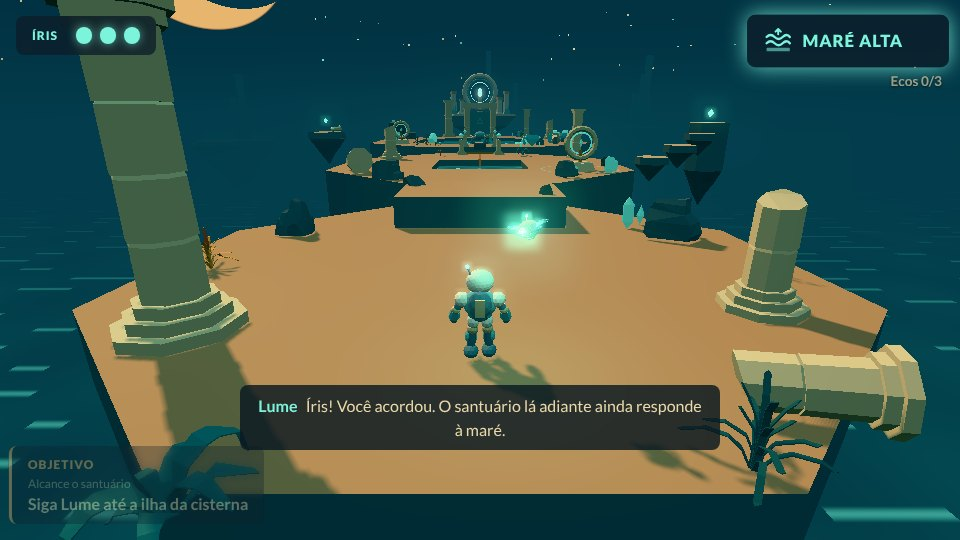
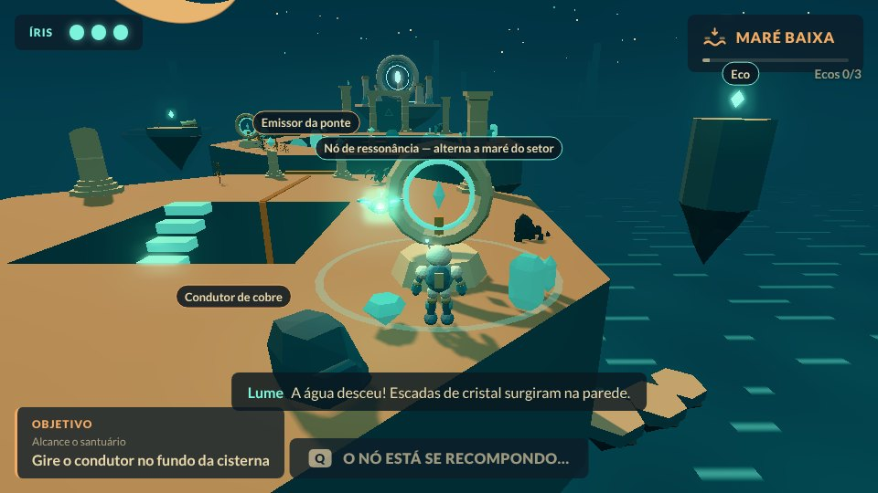
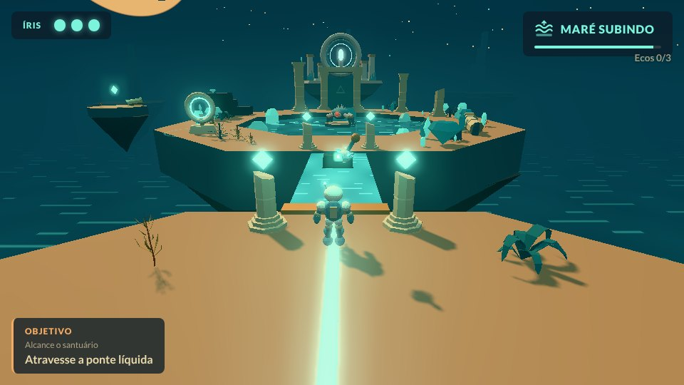
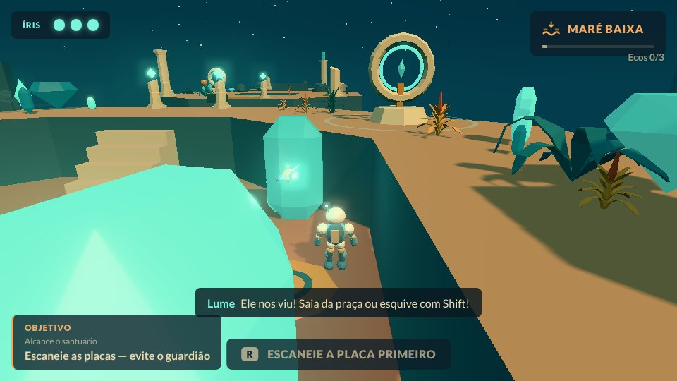
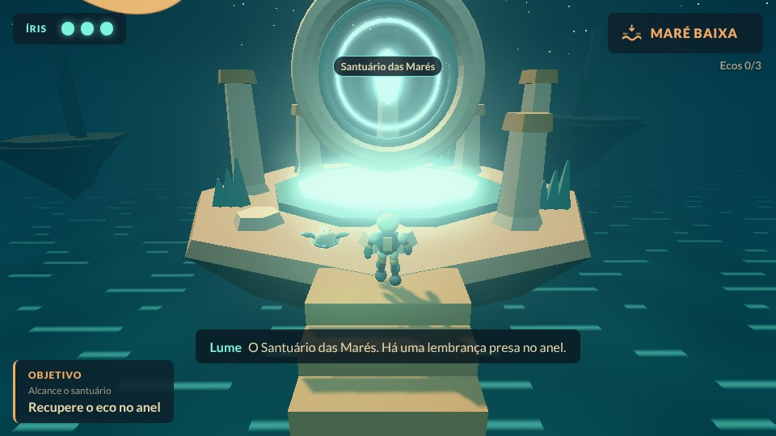

# Maré de Vidro — fatia vertical jogável (Jardim Mineral)

> *Um oceano suspenso. Uma memória que insiste em voltar.*

Implementação jogável da **fatia vertical do Jardim Mineral** descrita no GDD
([`docs/Mare_de_Vidro_GDD.pdf`](docs/Mare_de_Vidro_GDD.pdf), página 13): Íris
controlável em terceira pessoa, Lume, alternância da maré, um puzzle composto,
um guardião, checkpoints, HUD mínima e som provisório. Roda direto no navegador
(Three.js + WebGL), com teclado/mouse ou controle.



| Maré baixa: cisterna drenada | Ponte líquida | Guardião em alerta | Santuário das Marés |
| --- | --- | --- | --- |
|  |  |  |  |

## Jogar

```bash
npm install
npm run dev        # abre em http://127.0.0.1:5173
```

Build estático (funciona em qualquer subpasta — GitHub Pages, itch.io etc.):

```bash
npm run build      # gera dist/
npm run preview
```

Para hosts que não servem `.glb`, `npm run build:artifact` gera `dist-artifact/`
com os mesmos modelos convertidos para glTF JSON (`tools/glb-to-gltf-json.mjs`).

Parâmetros de URL úteis: `?quality=low` (sem sombras/bloom, para máquinas
fracas), `?skipintro`, `?autostart`.

### Controles (GDD 03)

| Ação | Teclado / mouse | Controle |
| --- | --- | --- |
| Mover | WASD / setas | Analógico esquerdo |
| Câmera | Mouse (clique para travar o cursor, ou arraste) · roda = distância | Analógico direito |
| Saltar · **segurar no ar: planar (até 3 s)** | Espaço | A |
| Interagir | E | X |
| Maré (segurar 1 s perto de um nó) | Q | Y |
| Escanear | R | RB |
| Esquivar | Shift | B |
| Pausa (diário, opções, checkpoint) | Esc | Start |

## O que acontece na fatia (roteiro do GDD, 12–15 min)

| Minuto | Etapa | No jogo |
| --- | --- | --- |
| 00–02 | Chegada | Câmera apresenta o santuário; Íris acorda no Farol Nulo e **plana** do mirante até a ilha da cisterna. |
| 02–05 | Descoberta | **Escanear** o nó de ressonância (R) e **baixar a maré** (segurar Q) — a cisterna drena e escadas de cristal surgem. |
| 05–08 | Travessia | Descer, **girar o condutor** (E), subir, **subir a maré**: o circuito alimenta a **ponte líquida**. |
| 08–11 | Guardião | No Jardim, baixar a maré expõe as placas da praça e acorda o **Guardião de Sal**. Escanear, achar a placa conectada usando os cristais como cobertura e **enviar Lume ao relé** — o guardião é pacificado e o portão abre. |
| 11–15 | Recompensa | Recuperar o **eco** no anel do santuário, ver o **atalho** de cerâmica se erguer e **descansar/salvar**. Tela final com tempo, quedas, contatos, dicas e alternâncias de maré (métricas do teste de aprovação). |

Há ainda **2 ecos opcionais**: um no alto das plataformas de flutuação (só sobem
na maré alta) e outro numa ilhota alcançável apenas planando da torre de pedra.

### Regras do GDD implementadas

- **Maré binária por setor**, sem relógio global; alternar só perto de nós, após
  **1 s** de confirmação; transição de **2,5 s**; **cooldown de 5 s**; o nó
  **recusa subir a maré** se Íris estiver em volume inseguro.
- Maré baixa: expõe ruínas e placas, cristais sólidos e escadas, guardião
  patrulha o piso seco. Maré alta: ponte líquida, plataformas de flutuação.
- **Falha e recuperação**: queda ou água devolvem ao último piso seguro;
  integridade de **3 segmentos**; contato com o guardião tira 1 segmento;
  zerada, reinicia no checkpoint; santuário restaura. Ecos nunca se perdem.
- **Guardião sem combate**: patrulha → alerta audiovisual (núcleo coral, som,
  cone de visão no chão) → perseguição limitada → repouso; esquiva com
  invulnerabilidade; resolução pelo relé.
- **Lume**: segue sem colisão, escaneia, marca pontos com um feixe, leva o sinal
  ao relé e dá **dicas em 3 níveis** após 30 s sem progresso (desligáveis).
- **HUD**: integridade, maré com **ícone + texto + cor** (não depende só de cor),
  objetivo, prompt contextual com barra de "segurar", legendas.
- **Save local versionado**, gravação atômica com **backup** e checksum;
  migração de versões; checkpoints antes dos encontros.
- **Acessibilidade**: modo assistido (janelas maiores, dicas mais cedo, planar
  mais longo, guardião mais lento), sensibilidade, inverter eixo, tamanho de
  texto, legendas, reduzir movimento de câmera, bloom, alto contraste,
  qualidade gráfica, volumes. **PT-BR e inglês**, textos externalizados.
- Áudio provisório **procedural** (WebAudio): pads que mudam com a maré, sinos
  de vidro, camada de alerta e sinais distintos de ativação, falha e sucesso.

## Modelos 3D

| Origem | Uso | Licença |
| --- | --- | --- |
| Kit original do projeto (`art_source/kit_original/`) | Íris, Lume, Guardião de Sal e Santuário das Marés — com **rig procedural** criado em código (pivôs nas juntas) para idle, caminhada, salto, planar, escaneamento, interação, esquiva; patas do guardião em marcha trípode | Do projeto |
| **Quaternius** — baixados da internet (`public/models/quaternius/`, 33 GLBs) | Cristais, rochas, colunas quebradas, canos de cobre, alavanca do relé, plantas/corais, gema dos ecos — **recoloridos em tempo real com a paleta da bíblia de arte** | **CC0 1.0** — ver [`LICENSE.txt`](public/models/quaternius/LICENSE.txt) |

Ilhas, cisterna, praça, ponte líquida, céu, planeta crescente e oceano suspenso
são geometria procedural low-poly na mesma paleta (abismo, petróleo, cerâmica,
cobre, ressonância, sal vivo).

## Testes

```bash
npm test                                         # unitários (Node)
npm run dev & npm run test:e2e                   # ponta a ponta (Chromium/Playwright)
```

- **Validação de conteúdo** (`tests/unit/puzzle.test.js`): explora *todos* os
  estados alcançáveis do puzzle a partir de **maré inicial alta e baixa** e
  prova que a fatia é concluível e que **não existe estado sem saída**; cada nó
  opera nos 2 estados; nós não ficam em volumes inseguros.
- Maré (tempos e recusas), save (atômico, backup, checksum, migração) e física
  (degraus, paredes, bordas, plataformas móveis, alcance do salto vs. planar).
- **E2E** (`tests/e2e/smoke.mjs`): joga a fatia inteira num navegador real com
  teclado — andar, saltar, planar, queda, escanear, maré, escada, condutor,
  ponte, guardião (detecção e contato), relé, portão, escadaria, eco, atalho,
  descanso, save e **continuar após recarregar**. Salva screenshots se receber
  uma pasta: `node tests/e2e/smoke.mjs <url> docs/screenshots`.

### Vídeo de gameplay

[`docs/video/mare-de-vidro-gameplay.mp4`](docs/video/mare-de-vidro-gameplay.mp4) mostra a fatia inteira, do
menu à tela final, jogada por um piloto automático (`tools/record/pilot.js`)
que usa as mesmas entradas de um jogador — analógico de movimento, salto/planar,
E, Q, R e Shift, sem teletransporte. Para regravar:

```bash
npm run dev            # em outro terminal
node tools/record/record.mjs --tune   # ensaio rápido: lista falhas do roteiro
npm run record         # grava docs/video/mare-de-vidro-gameplay.mp4 (1280x720, 30 fps, com som)
```

O relógio da página é controlado quadro a quadro (1/30 s de jogo por quadro),
então o vídeo sai em velocidade real mesmo em máquinas sem GPU; o áudio é
renderizado depois, com o mesmo motor de áudio do jogo, a partir dos eventos
registrados durante a gravação.

Utilitários de desenvolvimento em `tools/`: `model-sheet.html` (prancha de
modelos para avaliar GLBs) e `shot.cjs` (screenshot automatizado do jogo).

## Arquitetura (nomes do GDD 13)

```
src/
  systems/PuzzleGraph.js   regras puras do puzzle + grafo de áreas (testável)
  systems/TideManager.js   TideManager / confirmação de nó (HoldToConfirm)
  systems/SaveManager.js   save versionado, atômico, com backup
  actors/Guardian.js       GuardAI (máquina de estados) + rig do guardião
  actors/Lume.js           LumeFollower + rig do drone
  actors/Iris.js           rig procedural e animações da Íris
  player/PlayerController  movimento, salto com tolerância, planar, esquiva
  player/CameraRig.js      terceira pessoa com colisão + cinemáticas
  world/level.js           Jardim Mineral (layout, colisores, interativos)
  world/physics.js         colisores prismáticos + corpo do personagem
  core/                    assets/recoloração, áudio, entrada, paleta
  ui/ui.js, i18n.js        HUD, menus, PT-BR/EN
```

Lógica de jogo e efeitos ficam desacoplados por eventos (maré, guardião), como
pede o GDD — o que facilita portar os sistemas para Godot 4 depois: cada
módulo de `systems/` mapeia para um nó/recurso.

## Próximos passos sugeridos

1. Playtest com 8 pessoas externas usando as métricas da tela final (critério
   de aprovação do GDD: 6/8 concluem sem instrução, mediana ≤ 15 min).
2. Rig e animações finais da Íris no Blender (o rig atual é procedural).
3. Trilha e efeitos sonoros definitivos; remapeamento de teclas.
4. Decidir motor de produção (Godot 4.x, conforme GDD) a partir do slice validado.
