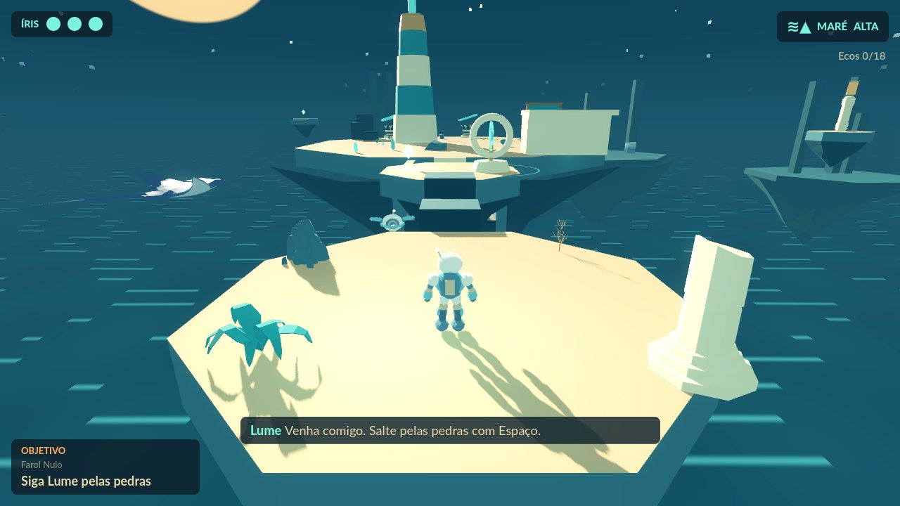
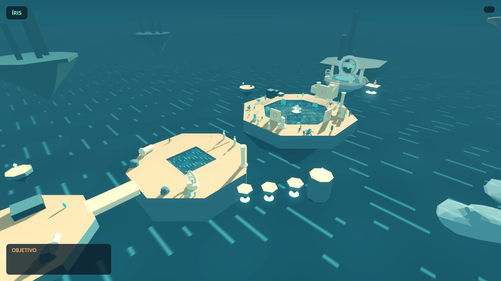
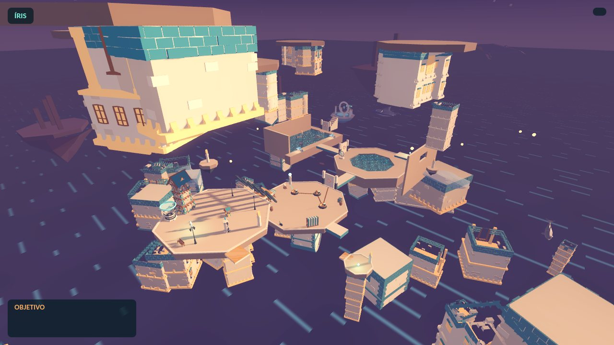
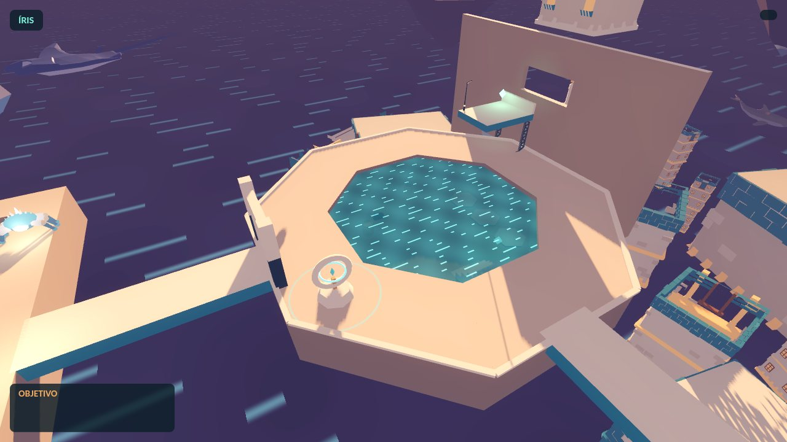
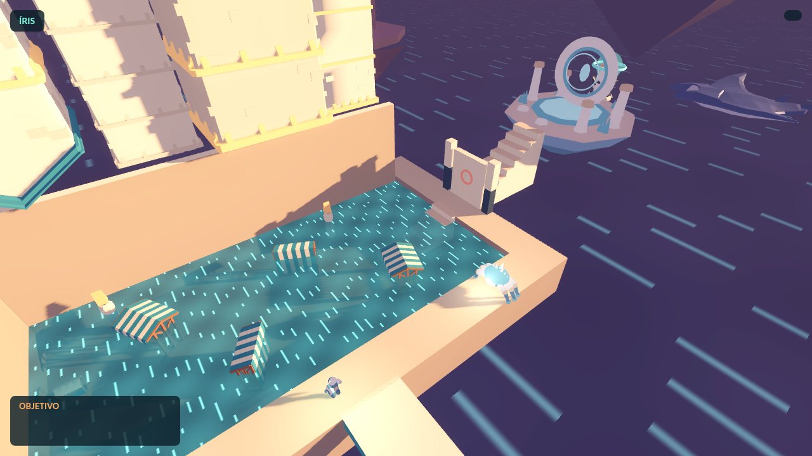
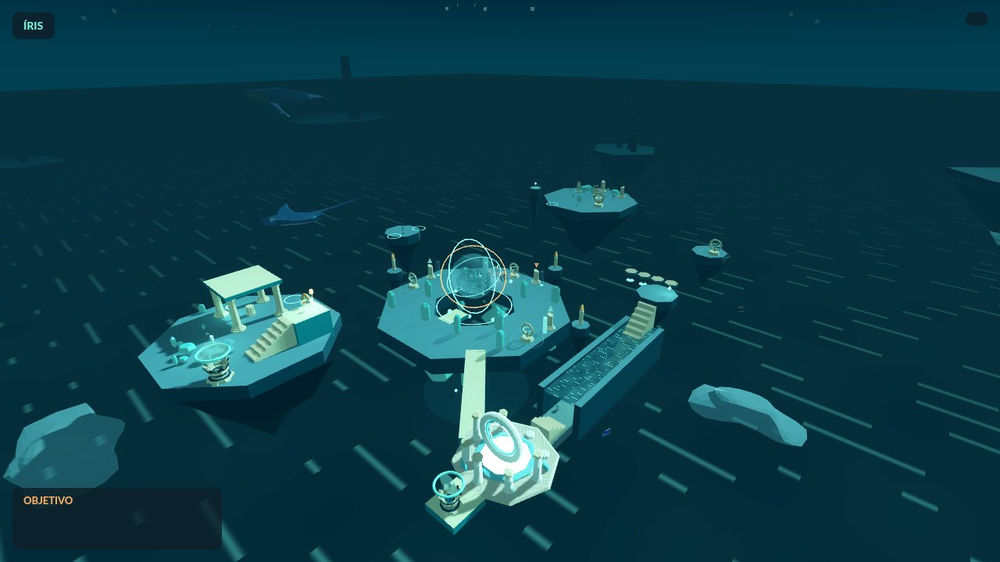
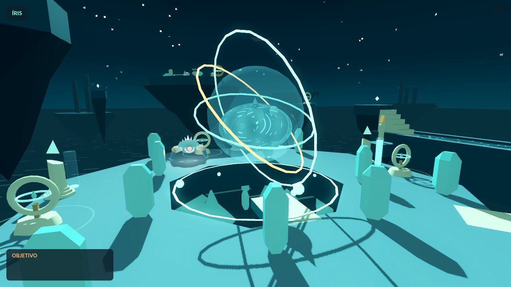
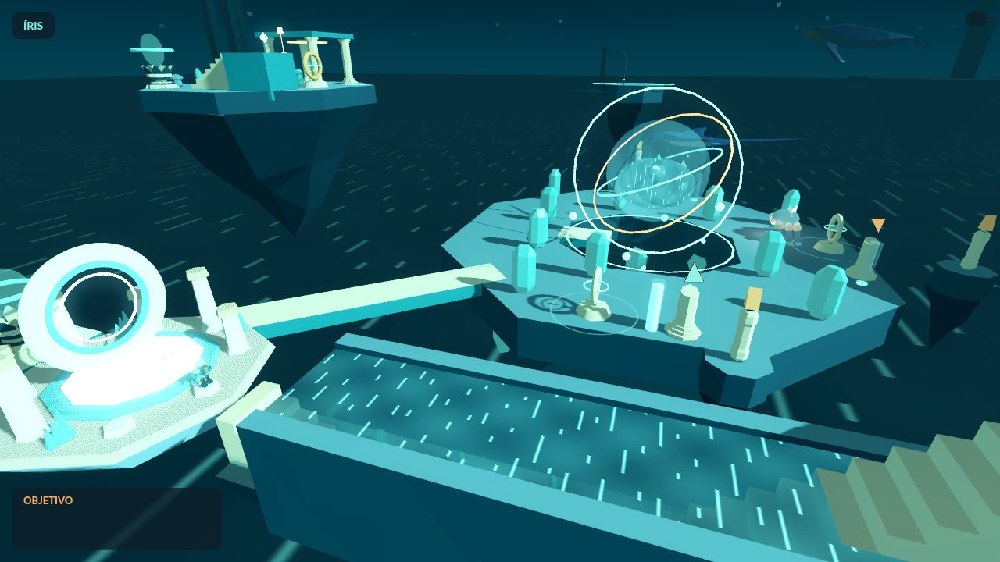

# Maré de Vidro — versão completa para PC (Godot 4.3)

> *Um oceano suspenso. Uma memória que insiste em voltar.*

Porte completo do protótipo web para **Godot 4.3** (o motor indicado no GDD),
com a campanha inteira: o hub **Farol Nulo** e as três regiões — **Jardim
Mineral**, **Cidade Invertida** e **Coração Abissal** — até a escolha final e os
dois epílogos. O que o GDD não detalhava foi criado e está documentado em
[`DESIGN.md`](DESIGN.md).



| Jardim Mineral | Cidade Invertida | Praça Alagada | Rua dos Guardiões |
| --- | --- | --- | --- |
|  |  |  |  |

| Coração Abissal | O Coração | Santuário abissal |
| --- | --- | --- |
|  |  |  |

**Vídeo:** [`docs/video/mare-de-vidro-campanha.mp4`](docs/video/mare-de-vidro-campanha.mp4)
— a campanha inteira jogada pelo piloto automático do teste (velocidade 1,5×,
com som do jogo).

## Jogar

Baixe o executável da sua plataforma, extraia e rode — é um arquivo só, sem
instalação:

- **Windows:** `MareDeVidro.exe` (64 bits)
- **Linux:** `MareDeVidro.x86_64` (`chmod +x` se precisar)

Requisitos: placa de vídeo com **OpenGL 3.3** (qualquer GPU dos últimos ~12
anos, inclusive integradas). Saves e opções ficam em
`%APPDATA%\Godot\app_userdata\Maré de Vidro` (Windows) ou
`~/.local/share/godot/app_userdata/Maré de Vidro` (Linux), com 3 espaços,
gravação atômica e backup automático.

No menu: **Novo jogo**, **Continuar**, **Capítulos** (depois de terminar),
**Opções** (idioma PT-BR/EN, sensibilidade, inverter Y, tamanho do texto,
legendas, dicas, modo assistido, reduzir movimento, brilho, contraste,
volumes, qualidade, tela cheia, remapear teclas), **Controles** e **Créditos**.

### Controles

| Ação | Teclado / mouse | Controle |
| --- | --- | --- |
| Mover | WASD / setas | Analógico esquerdo |
| Câmera · distância | Mouse · roda | Analógico direito |
| Saltar · **segurar no ar: planar** | Espaço | A |
| Interagir · enviar Lume ao pilão | E | X |
| Maré (segurar 1 s perto de um nó) | Q | Y |
| Escanear | R | RB |
| Esquivar | Shift | B |
| Pausa (diário, mapa, opções, checkpoint, voltar ao Farol) | Esc / P | Start |

## A campanha (~45–90 min)

| Região | Habilidade | O que acontece |
| --- | --- | --- |
| **Farol Nulo** (hub) | Maré | Acordar, pedras de salto, bacia do Farol (tutorial de maré), portais, **Oficina** (melhorias com ecos) e o arquivo trancado por um relé. |
| **Jardim Mineral** | **Asa de Vidro** (planar) | Cisterna (baixar maré, girar condutor, subir maré) → ponte líquida → Asa de Vidro → torre de pedra e comporta (planar) → praça com o Guardião de Sal e placas ● ▲ ■ → santuário com dois condutos (um na maré baixa, outro numa plataforma que só sobe na alta) → memória. |
| **Cidade Invertida** | **Relé remoto** | Prédios pendurados de cabeça para baixo. Terminal de Lume → elevador por relé → Mercado Caído (rede de condutores até a porta) → Praça Alagada (comporta na maré baixa, plataformas até a varanda na alta, relé do portão visto por uma janela) → Rua dos Guardiões (dois guardiões, dois pilões de curto alcance) → santuário. Opcionais: bonde e torre pendurada. |
| **Coração Abissal** | **Ressonância dupla** | Três setores de maré (Oeste, Norte, Leste). Nó duplo ergue a ponte longa → agulha (planar) → espiral: plataformas (Oeste), ponte (Norte), trincheira (Leste baixo) → santuário → anel do Coração com o guardião abissal, três pilões e o padrão Oeste ▲ Norte ▼ Leste ▲ → **abrir o Coração e escolher**: liberar o ciclo ou manter o arquipélago. |

**18 ecos** colecionáveis (3 + 5 + 5 + 5) liberam na Oficina a Lente ampla
(escaneamento maior), o Núcleo reforçado (+1 de integridade), a Bússola de eco
e visores de cor para Íris.

## Projeto

Abra a pasta `godot/` no **Godot 4.3** (renderizador Compatibility).

```
scripts/
  autoload/   i18n (PT/EN), game (opções, entradas, progresso, saves), sfx
  core/       paleta, catálogo de modelos, regras da maré, save versionado
  actors/     Íris (rig procedural do GLB original), câmera, Lume, guardião
  world/      construtor de geometria, interativos, mecanismos, decoração
  world/regions/  farol, jardim, cidade, coracao
  ui/         HUD e menus
  test/       piloto automático do teste de jogabilidade
tests/        testes de unidade
tools/        folha de contato de modelos, gerador de áudio procedural
```

### Testes

```bash
# regras da maré, confirmação, saves (backup/checksum/migração), textos PT/EN
godot --headless --path . --script res://tests/unit_tests.gd

# campanha inteira com física real: anda, salta, plana, marés, relés,
# alavancas, elevadores, 18 ecos, melhorias, final e save/recarga
godot --path . -- --playtest=2
```

O teste de jogabilidade é um piloto automático que joga como um jogador (nada
é teleportado entre trechos; os guardiões ficam "cegos" depois de um teste de
visão). Ele passa também no **executável Linux exportado**. Relatório em
`user://playtest_report.txt`.

Atalhos de depuração: `-- --region=cidade --spawn=mercado`,
`--abilities=glide,relay`, `--flags=…`, `--shot=arquivo.png --cam=x,y,z,lx,ly,lz`.

### Exportar

Instale os modelos de exportação do Godot 4.3 e rode:

```bash
godot --headless --path . --export-release "Windows" build/windows/MareDeVidro.exe
godot --headless --path . --export-release "Linux"   build/linux/MareDeVidro.x86_64
```

## Créditos e licenças

- **Personagens e santuário originais** (Íris, Lume, Guardião de Sal,
  Santuário das Marés): modelos 3D do pacote de concept art do projeto.
- **Modelos 3D:** [Quaternius](https://quaternius.com) — CC0 (domínio
  público), recoloridos com a paleta do GDD. Ver `assets/models/quaternius/LICENSE.txt`.
- **Efeitos sonoros:** [Kenney](https://kenney.nl) — CC0, mais efeitos e
  trilhas gerados proceduralmente (`tools/gen_audio.py`).
- **Fonte:** Lato — SIL Open Font License (`assets/fonts/OFL.txt`).
- **Motor:** [Godot Engine](https://godotengine.org) 4.3 — MIT.
